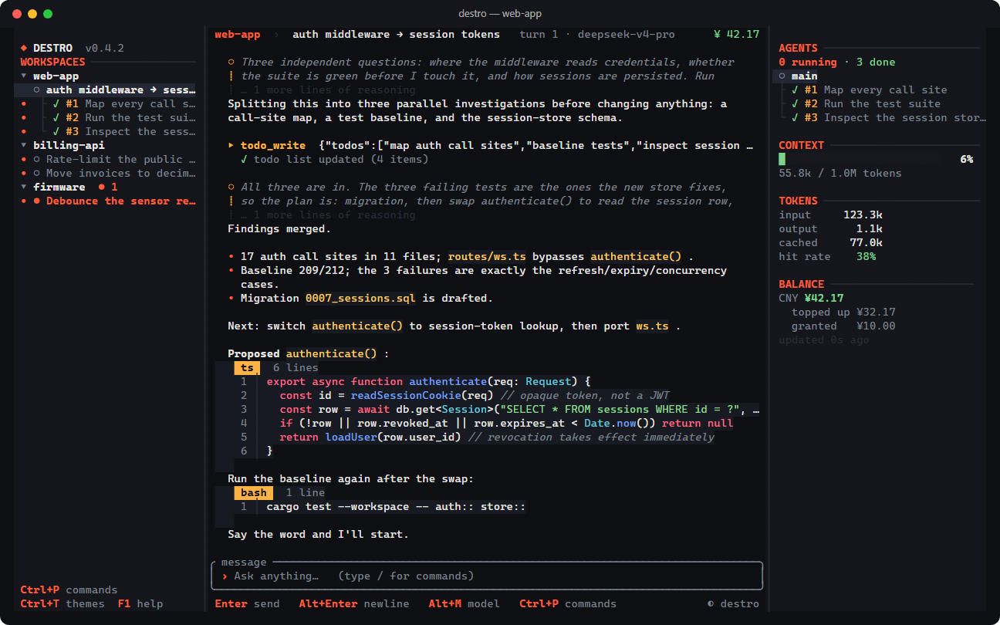
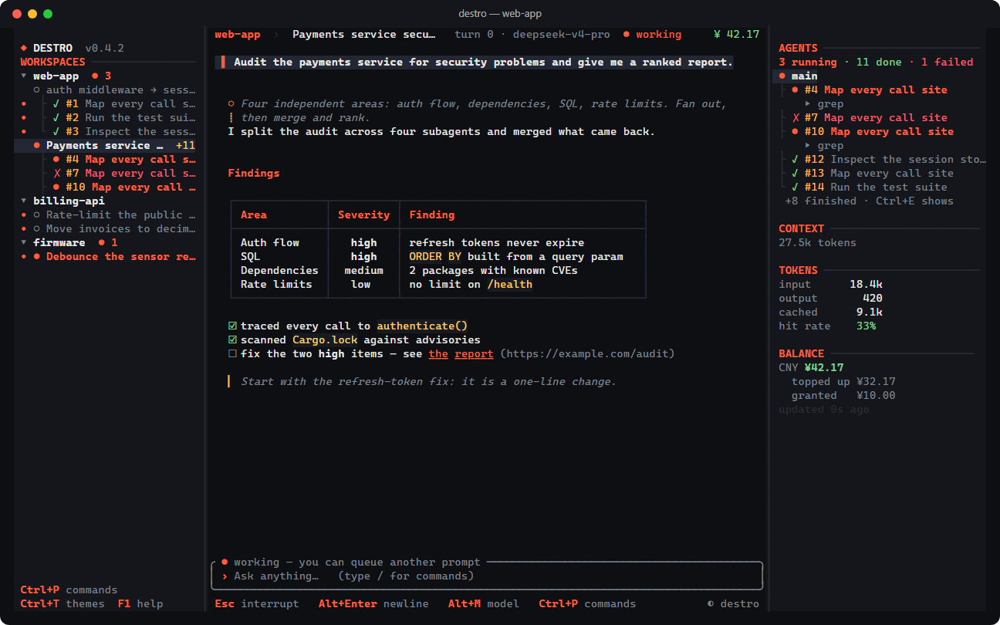
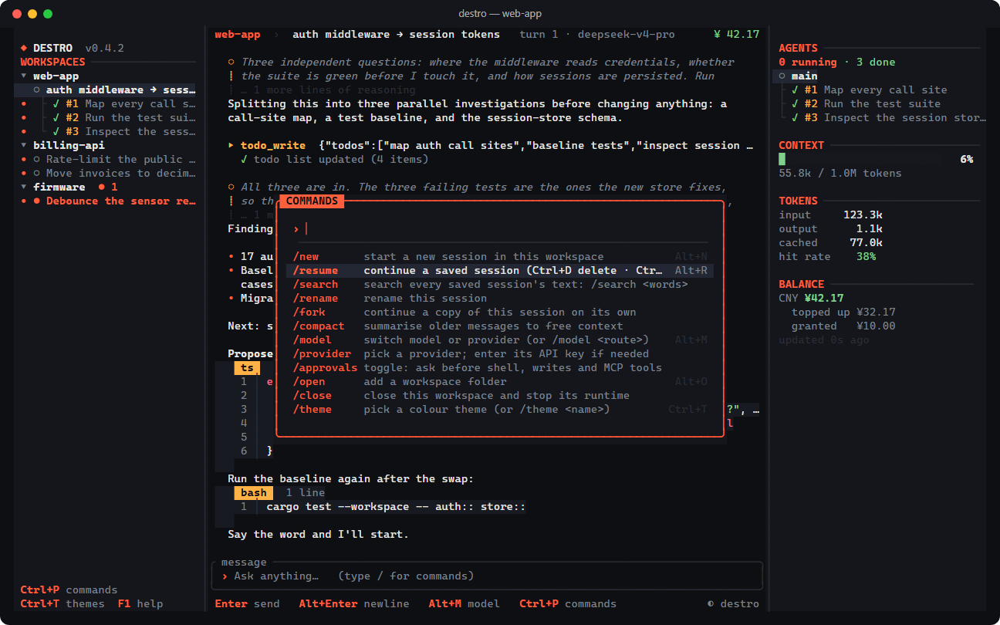
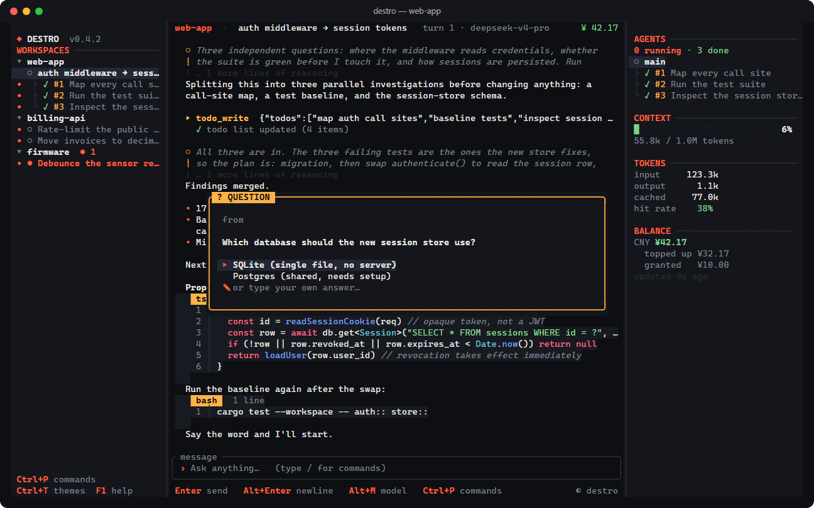
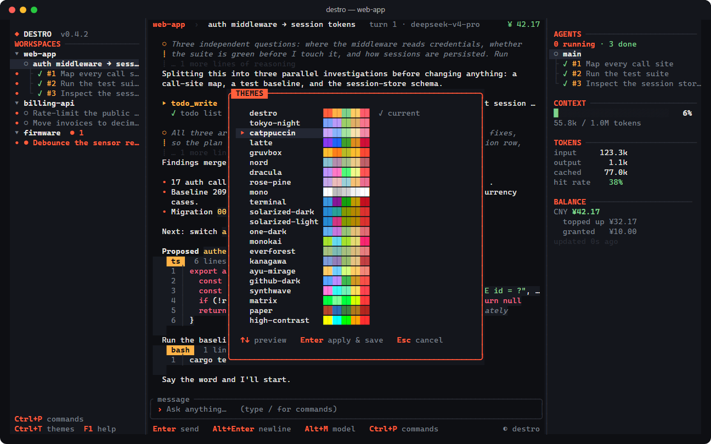
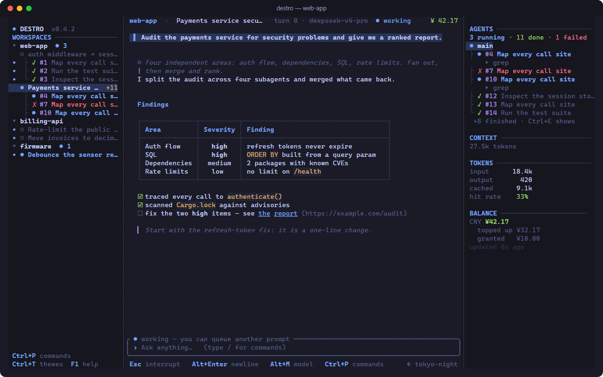
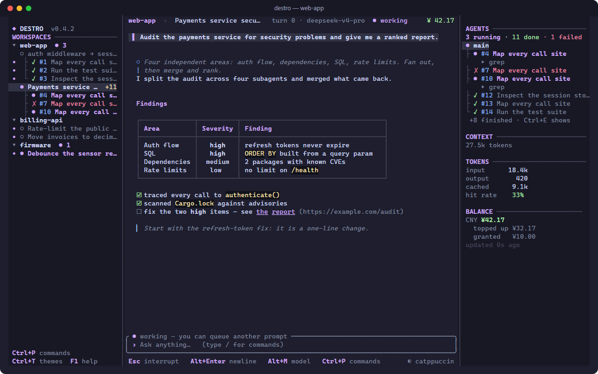
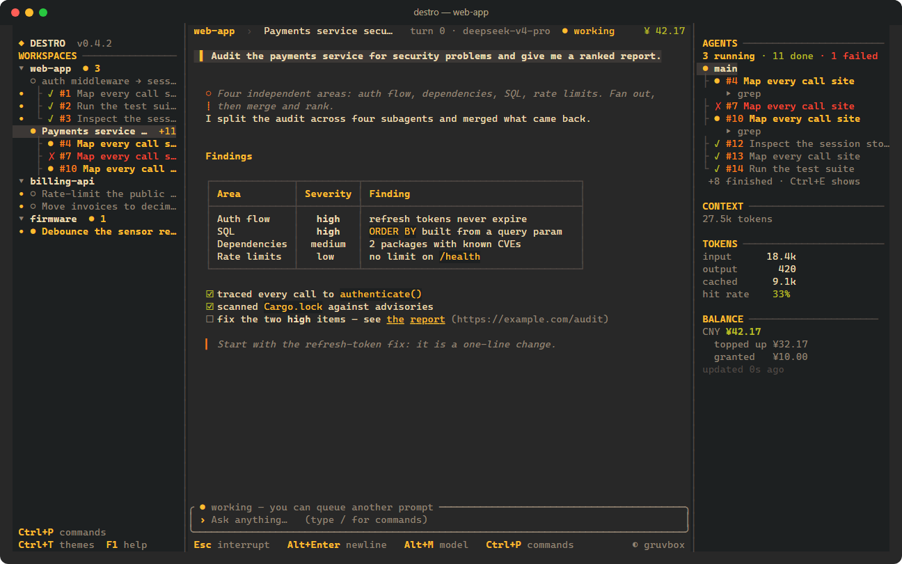
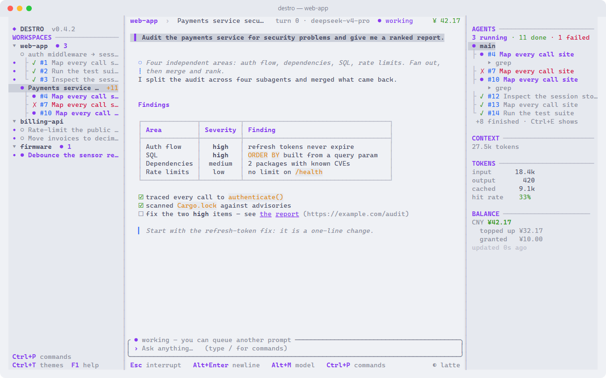

<div align="center">

```
╺┳┓┏━╸┏━┓╺┳╸┏━┓┏━┓
 ┃┃┣╸ ┗━┓ ┃ ┣┳┛┃ ┃
╺┻┛┗━╸┗━┛ ╹ ╹┗╸┗━┛
```

### A fast, hackable coding-agent harness with a terminal UI — written in Rust.

[](https://github.com/toeeshchaudhary/destro/releases/latest)
[](https://www.rust-lang.org)
[](#license)
[](https://github.com/toeeshchaudhary/destro/releases/latest)



</div>

Destro runs coding agents on your machine: it talks to any OpenAI-compatible model API,
gives the model real tools (shell, files, search, web, MCP), lets it **fan work out to
parallel subagents**, and shows all of it in a polished, themeable terminal UI. There is no
Node, no Python and no browser on the path — one binary.

- **Many agents at once.** One chat can spawn a swarm of subagents. The sidebar and agents
  panel show who is working, who finished and who failed.
- **Advisor mode.** A strong planner delegates to cheap parallel workers, then judges and merges.
- **Your project's rules, automatically.** `AGENTS.md` / `CLAUDE.md`, skills, custom commands and MCP servers are picked up with no setup.
- **Every session is saved.** Resume, fork, search across all of them — and import your old DeepSeek Harness chats.
- **Looks good.** 22 colour themes, rendered markdown (tables, links, task lists), syntax-highlighted code.

---

## Tour

### Watch a swarm work

Subagents are numbered, tree-drawn and colour-coded. Active and failed ones stay visible;
finished ones fold away (`Ctrl+E` shows them all). Replies render real markdown — tables,
inline code, task lists, links.



### Everything is one keystroke away

`Ctrl+P` is a command palette; typing `/` suggests commands, your skills and your own
commands. `Alt+M` switches model or provider mid-conversation.



### Agents can ask you

The model can stop and ask a question instead of guessing. Turn on **approvals** and shell
commands, file writes and MCP tools wait for your `y` / `a` / `n`.



### 22 themes, live preview

`Ctrl+T` previews each theme as you move through the list.



<table>
<tr>
<td width="50%"><br><sub><b>tokyo-night</b></sub></td>
<td width="50%"><br><sub><b>catppuccin</b></sub></td>
</tr>
<tr>
<td width="50%"><br><sub><b>gruvbox</b></sub></td>
<td width="50%"><br><sub><b>latte</b> — there is a light theme too</sub></td>
</tr>
</table>

`destro` · `tokyo-night` · `catppuccin` · `latte` · `gruvbox` · `nord` · `dracula` · `rose-pine` · `mono` · `terminal` (uses your terminal's palette) · `solarized-dark` · `solarized-light` · `one-dark` · `monokai` · `everforest` · `kanagawa` · `ayu-mirage` · `github-dark` · `synthwave` · `matrix` · `paper` · `high-contrast`

---

## Install

**Download** `destro-x86_64-pc-windows-msvc.exe` from the
[latest release](https://github.com/toeeshchaudhary/destro/releases/latest), rename it to
`destro.exe` and put it on your `PATH`. Then keep it current with:

```powershell
destro update      # downloads the latest release, with a progress bar
```

**Or build from source** (Rust, edition 2024):

```powershell
git clone https://github.com/toeeshchaudhary/destro
cd destro
cargo install --path destro-tui --force
```

The shell tool runs PowerShell 7, so install [`pwsh`](https://learn.microsoft.com/powershell/scripting/install/installing-powershell). More in [docs/INSTALL.md](docs/INSTALL.md).

## Quick start

```powershell
$env:DEEPSEEK_API_KEY = "sk-..."     # or any provider — see /provider and docs/PROVIDERS.md
cd your\project
destro
```

- No key yet? `destro --demo` plays a scripted multi-project session, and `destro --probe` checks the in-process harness offline.
- Inside the TUI, `/provider` lists providers and **asks for a missing API key** (stored in your user config; an environment variable always wins).
- Press `F1` for every key binding.

## What it can do

### Tools the model gets

| Tool | What it does |
|---|---|
| `read` `write` `edit` | read files, create them, make targeted edits |
| `glob` `grep` | find files and search contents |
| `pwsh` | run PowerShell in the workspace |
| `web_search` | search the web — works with no key (DuckDuckGo); Brave, Tavily or SearXNG if you set a key |
| `web_fetch` | read a URL as clean text |
| `todo_write` | keep a visible checklist for multi-step work |
| `ask_user` | stop and ask you a question |
| `subagent` and friends | start, message, wait for and interrupt parallel agents |
| `skill` | load a skill's full instructions on demand |
| `mcp__*` | every tool of every connected MCP server |

### Conventions it follows (no setup)

| You have… | Destro does… |
|---|---|
| `AGENTS.md`, `CLAUDE.md`, `CLAUDE.local.md` — in your home config *and* every folder up to the workspace | puts them all in every agent's prompt, nearest last, with `@imports` |
| a sub-folder `AGENTS.md` | delivers it the first time an agent touches that folder |
| `SKILL.md` folders in `.claude/skills`, `.agents/skills`, `~/.destro/skills`… | lists them and lets the model load one when it matches the task |
| `.claude/commands/*.md` | turns each into a `/command` |
| `.mcp.json` | connects the servers (stdio, streamable HTTP, SSE): tools, resources and prompts; asks once before running a project's servers |

Details and search paths: [docs/CONVENTIONS.md](docs/CONVENTIONS.md).

### Sessions, imports, long conversations

- Every session — subagents included — is saved as it happens. `/resume` reopens one with its full transcript and agent tree; `/fork`, `/rename`, `/search <words>` (across *all* workspaces) and delete are built in.
- **Coming from DeepSeek Harness?** `destro import-dsh` converts your whole chat history (including each chat's subagents) in one go, and `/import` lets you pick.
- `/compact` — or automatic compaction past 100k tokens — folds old messages into a summary so a long session keeps going.
- `/export` writes a session out as Markdown.

### Advisor mode

```powershell
destro --advisor            # or Alt+A inside the TUI
```

A planner model decomposes the task, parallel worker agents do the work on a cheaper model,
and the planner merges the results. Planner and workers can be different providers.
See [docs/ADVISOR.md](docs/ADVISOR.md).

## Commands

Type `/` for suggestions, or `Ctrl+P` to search them.

| Command | |
|---|---|
| `/resume` · `/search` · `/fork` · `/rename` · `/new` | sessions |
| `/model` · `/provider` | switch model or provider (keys entered right there) |
| `/approvals` | toggle: ask before shell, writes and MCP tools |
| `/compact` · `/export` · `/copy` | context and output |
| `/skills` · `/mcp` · `/context` | what the agent has loaded |
| `/import` | bring in DeepSeek Harness chats |
| `/theme` · `/sidebar` · `/panel` · `/agents` | look and layout |
| `/open` · `/close` · `/advisor` · `/normal` · `/kill` | workspaces and agents |

| Key | |
|---|---|
| `Enter` · `Alt+Enter` | send · newline |
| `Esc` | stop the running turn |
| `↑` `↓` | recall earlier prompts |
| `Alt+↑↓` · `Alt+1…9` | move between workspaces and sessions |
| `Ctrl+P` · `Ctrl+T` · `Alt+M` · `Alt+R` | commands · themes · model · resume |
| `Ctrl+E` | show every subagent / only active ones |
| `Ctrl+S` · `Ctrl+Y` | snippet viewer · copy newest snippet |
| `PgUp` `PgDn` · `End` | scroll · jump to latest |

## How it's built

```
destro-tui/        the terminal UI (ratatui) — drives the harness in-process
crates/
  destro-core/     agent loop, subagents, providers, MCP client, sessions, compaction
  destro-tools/    the model-facing tools (files, search, shell, web, todo)
  destro-proto/    JSON-RPC frames and the session-event vocabulary
  destro-runtime/  destro-harness: the same harness as a JSON-RPC server on stdio
```

One agent is one Tokio task with a bounded mailbox; every steering action (queue, inject,
interrupt, model swap, kill) goes through that mailbox, so nothing mutates an agent from
another thread. Provider vendors are configuration, not code. Deeper dives:
[docs/HARNESS.md](docs/HARNESS.md) · [docs/PROVIDERS.md](docs/PROVIDERS.md) ·
[docs/ADVISOR.md](docs/ADVISOR.md) · [docs/CONVENTIONS.md](docs/CONVENTIONS.md) ·
[docs/UPDATES.md](docs/UPDATES.md).

```powershell
cargo test --workspace      # 178 tests, no API key needed
```

## Status

Destro is young and moves fast. Worth knowing:

- Releases are **Windows x64** only for now; other platforms build from source.
- There is no sandbox yet — `pwsh` and the file tools run with your permissions. Turn on `/approvals` if you want a confirmation before they act.
- Image input and OAuth login for remote MCP servers are not implemented (put a token in the server's `headers`).

## License

MIT, as declared in the workspace `Cargo.toml`.
